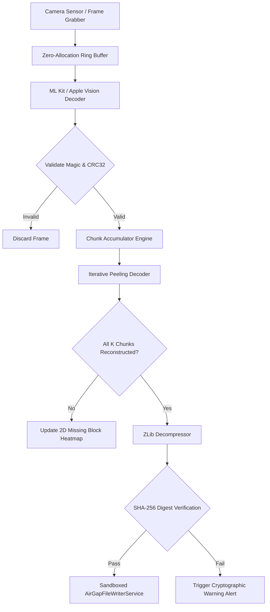

# Visual ZeroSync Optical Protocol Specification

**Specification Version:** 1.0.0  
**Transport Medium:** Optical Screen-to-Camera Line of Sight  
**Protocol Classification:** Unidirectional Rateless Fountain Transfer  

---

## 1. Protocol Overview & Motivation

In high-security, air-gapped operating environments, physical radio communications (Wi-Fi, Bluetooth, NFC, Cellular) are strictly forbidden or hardware-disabled to prevent data leakage and remote exploitation.

The **Visual ZeroSync Protocol** provides high-bandwidth, unidirectional inter-device data synchronization through an optical channel. The transmitting device rapidly modulates sequential QR code frames on its display screen, while the receiving device decodes and reconstructs the data stream via high-speed camera frame capture.

To overcome the inherent optical challenges—such as motion blur, dropped camera frames, reflections, and user hand-shake—the protocol implements **Luby Transform (LT) Rateless Fountain Erasure Codes**. This eliminates the requirement for a two-way reverse acknowledgment channel.

---

## 2. Wire Transport Frame Format

Every visual QR frame in a ZeroSync stream encapsulates a standardized binary frame comprised of a **13-Byte Packed Transport Header** followed by a variable-length payload chunk:

```
 0                   1                   2                   3
 0 1 2 3 4 5 6 7 8 9 0 1 2 3 4 5 6 7 8 9 0 1 2 3 4 5 6 7 8 9 0 1
+-+-+-+-+-+-+-+-+-+-+-+-+-+-+-+-+-+-+-+-+-+-+-+-+-+-+-+-+-+-+-+-+
|   Magic Byte  |Version| Flags |          Stream ID            |
|     (0x5A)    | (0x01)|(1Byte)|          (16 Bits)            |
+-+-+-+-+-+-+-+-+-+-+-+-+-+-+-+-+-+-+-+-+-+-+-+-+-+-+-+-+-+-+-+-+
|       Sequence Number         |          Total Chunks         |
|           (16 Bits)           |            (16 Bits)          |
+-+-+-+-+-+-+-+-+-+-+-+-+-+-+-+-+-+-+-+-+-+-+-+-+-+-+-+-+-+-+-+-+
|   FEC Degree  |                    Reserved                   |
|    (8 Bits)   |                    (24 Bits)                  |
+-+-+-+-+-+-+-+-+-+-+-+-+-+-+-+-+-+-+-+-+-+-+-+-+-+-+-+-+-+-+-+-+
|                      Payload Data Bytes...                    |
|             (Chunk Size: Typically 128 - 512 Bytes)           |
+-+-+-+-+-+-+-+-+-+-+-+-+-+-+-+-+-+-+-+-+-+-+-+-+-+-+-+-+-+-+-+-+
|                        CRC32 Checksum                         |
|                   (32 Bits, IEEE 802.3)                       |
+-+-+-+-+-+-+-+-+-+-+-+-+-+-+-+-+-+-+-+-+-+-+-+-+-+-+-+-+-+-+-+-+
```

### 2.1 Header Field Definitions

| Field | Size | Type | Description |
| :--- | :--- | :--- | :--- |
| **Magic Byte** | 1 Byte | `uint8` | Fixed constant `0x5A` (ASCII `'Z'`), confirming ZeroSync wire format. |
| **Version** | 1 Byte | `uint8` | Protocol version. Current release: `0x01`. |
| **Flags** | 1 Byte | `uint8` | Bitfield: `0x01` = Compressed (ZLib), `0x02` = Encrypted, `0x04` = Fountain Droplet. |
| **Stream ID** | 2 Bytes | `uint16_be` | Unique 16-bit identifier for the active transmission session. |
| **Sequence Number** | 2 Bytes | `uint16_be` | Droplet sequence index ($0 \le seq < 65535$). |
| **Total Chunks** | 2 Bytes | `uint16_be` | Total original source chunks $K$ required for reconstruction. |
| **FEC Degree** | 1 Byte | `uint8` | Number of source chunks combined via XOR in this droplet ($d \ge 1$). |
| **Reserved** | 3 Bytes | `bytes` | Reserved for alignment and future expansion. Must be `0x00`. |
| **Payload** | $N$ Bytes | `bytes` | Raw or XOR-combined chunk data bytes. |
| **CRC32** | 4 Bytes | `uint32_be` | IEEE 802.3 checksum covering Header + Payload. |

---

## 3. Mathematical Foundations: Luby Transform Erasure Coding

### 3.1 The Fountain Concept
Given a file decomposed into $K$ source chunks $S_1, S_2, \dots, S_K$, standard packet transfer requires retransmitting missing chunks. In an air-gapped optical link, there is **no uplink** to request retransmission.

The Luby Transform acts as a mathematical "fountain", producing an infinite stream of encoded droplets $D_1, D_2, \dots, D_M$. The receiver only needs to capture any $K' = K(1 + \epsilon)$ droplets (where overhead $\epsilon \approx 0.05$) to reconstruct the original payload.

### 3.2 Robust Soliton Distribution $\mu(d)$
Each droplet degree $d$ is sampled from the Robust Soliton Distribution $\mu(d)$, balancing degree-1 droplets (initiating the peeling decoder) with higher-degree droplets (ensuring every chunk is covered):

$$\rho(d) = \begin{cases} 
\frac{1}{K} & \text{for } d = 1 \\
\frac{1}{d(d-1)} & \text{for } d = 2, 3, \dots, K 
\end{cases}$$

$$\tau(d) = \begin{cases} 
\frac{S}{K \cdot d} & \text{for } d = 1, 2, \dots, \frac{K}{R} - 1 \\
\frac{S \cdot \ln(S / \delta)}{K} & \text{for } d = \frac{K}{R} \\
0 & \text{for } d > \frac{K}{R} 
\end{cases}$$

Where:
- $S \equiv c \cdot \ln(K / \delta) \sqrt{K}$
- $R \equiv K / S$
- $c \approx 0.1$, $\delta \approx 0.5$ (failure probability)

The distribution is normalized:
$$\mu(d) = \frac{\rho(d) + \tau(d)}{\sum_{i=1}^K (\rho(i) + \tau(i))}$$

### 3.3 Droplet Encoding Algorithm
For each transmitted droplet:
1. Seed a deterministic Pseudo-Random Generator with the droplet `Sequence Number`.
2. Sample degree $d \sim \mu(d)$.
3. Uniformly select $d$ distinct source chunk indices $\{i_1, i_2, \dots, i_d\} \subset \{1, \dots, K\}$.
4. Compute droplet payload $D = S_{i_1} \oplus S_{i_2} \oplus \dots \oplus S_{i_d}$.

---

## 4. Optical Receiver & Decoding Architecture



### 4.1 Iterative Peeling Decoding
1. **Degree-1 Ingestion:** When a droplet with $d = 1$ arrives, its payload corresponds directly to a known source chunk $S_i$.
2. **Back-Substitution:** $S_i$ is immediately XORed into all active higher-degree droplets connected to chunk $i$, reducing their degree: $d \leftarrow d - 1$.
3. **Ripple Effect:** Any droplet whose degree drops to 1 becomes a newly solved source chunk, cascading through the graph until all $K$ chunks are resolved.
4. **Gaussian Elimination Fallback:** If peeling stalls before $K$ chunks are resolved, remaining linear equations are solved via bitwise Gaussian elimination over $GF(2)$.

---

## 5. Visual Telemetry & Thermal Control

- **2D Missing Block Matrix Heatmap:** Renders a real-time grid of all $K$ chunks. As packets are decoded, cells transition from unreceived dark gray $\to$ received cyber green.
- **Dynamic Transmission Modulation:**
  - Standard devices: 15–20 FPS (optimal for mid-range camera sensors).
  - High-performance mode: 30–60 FPS (high-end sensors with manual exposure lock).
  - Contrast Inversion: Transmitters can toggle dark-on-light or light-on-dark for optimal scanning under direct sunlight or OLED glare.

